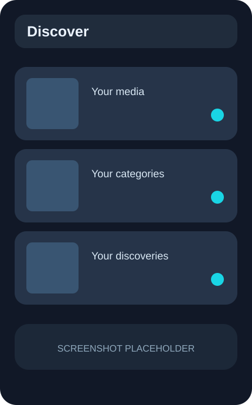
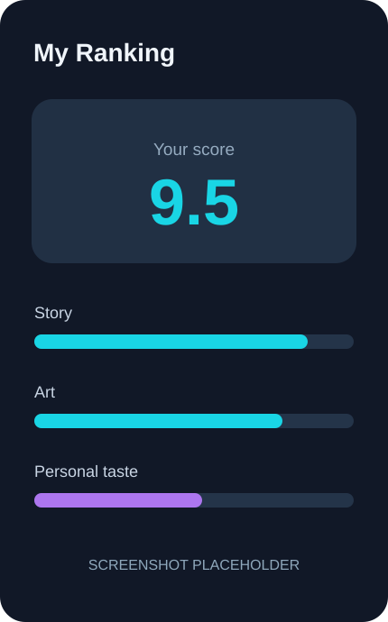

# RankOffline

**Rate what you love. Rank it your way. Keep it offline.**

RankOffline is a **local-first Android app** for browsing independently installed Anime, Manga, Movies, Series, and Books catalogs, rating entries with either a simple score or a configurable weighted system, and building personal rankings without an account or telemetry.

## Highlights

- **Five independent data-only packs** (Anime, Manga, Movies, Series and Books), downloadable independently of the Core APK.
- **Simple rating** from 0 to 10 in 0.5-point steps.
- **Elaborate rating** with reusable rating profiles, weighted categories, N/A support, and a separate personal-taste bonus.
- **Custom categories** with editable names, descriptions, colors, and stable IDs.
- **Custom profiles** with independent category weights; profiles can be created, renamed, edited, and deleted.
- **Personal ranking** driven by one canonical saved score per item or explicit group.
- Notes and watch status stored locally.
- Fully offline catalog search (including imported title aliases), filters, Merge and rankings after installation; no remote title discovery.
- Per-pack **Show Images**, **Sticky Score Header**, Merge and cover preferences. When enabled for a new pack, optional initial Top-100 covers download after catalog import; the catalog can be used while covers download.
- Validated user-requested Top-N cover downloads, removable per-pack image cache, and local offline reuse.
- Nine UI languages: English, Spanish, German, French, Russian, Japanese, Simplified Chinese, Basque, and Italian.
- Eight selectable launcher icons backed by verified Android launcher aliases.
- No analytics, telemetry, account system, or cloud rating storage.

## Rating system

RankOffline supports two rating modes.

### Simple

Choose a score from **0.0 to 10.0** in **0.5** steps. Saving writes that value directly to the canonical final score.

### Elaborate

Rate the configured categories and choose a **rating profile** that determines their relative weights. Categories marked **N/A** are excluded and the remaining applicable weights are normalized.

The default categories are:

- Writing
- Characters
- Visuals
- Worldbuilding
- Audio

The default profiles are designed around what primarily carries a work rather than around anime genres:

- General
- Narrative
- Character-driven
- Visual / Action
- World / Adventure
- Atmospheric

A separate personal-taste bonus ranges from **+0.0 to +1.0** in 0.1 steps. The final elaborate score is capped at 10.

Changing a profile later does **not** silently recalculate previously saved entries. A final score only changes when an entry is explicitly saved again.

See [docs/SCORING.md](docs/SCORING.md) for the complete model.

## Offline catalog

RankOffline Core is a small APK. Production catalogs are independently downloaded, verified and
installed as data-only packs; installed packs then provide browsing, search, ratings and ranking
fully offline.

Schema-v1 packs are verified and atomically installed below app-private `files/packs/`. Deleting a
pack is an explicit destructive purge of that pack and its PackId-scoped personal state. See
[`docs/CATEGORY_PACK_ARCHITECTURE.md`](docs/CATEGORY_PACK_ARCHITECTURE.md).

To rebuild the normalized pack set manually:

```bash
python3 tools/category_packs/build_category_packs.py
```

Provider-specific source tools produce normalized catalog/group snapshots, including conservative
Book-series groups and normalized Book genres. Group membership is derived offline from explicit
provider relationships; the Android Merge toggle never discovers or rewrites relationships.

Only catalog archives are installed automatically; cover-image binaries are not currently
redistributed in the five official packs. A new pack may optionally download its Top-100 cover
images to private storage when its **Show Images** setting is enabled. Failed or cancelled
cover downloads do not invalidate an otherwise usable installed catalog.

## Screenshots

Real-device screenshots will be added here after final 0.2.0 UI validation.

| Browse | Rate & rank |
|:---:|:---:|
|  |  |
| *Screenshots coming soon* | *Screenshots coming soon* |

<!-- Add privacy-reviewed captures to docs/screenshots/ and then uncomment links such as:


Do not commit screenshots containing personal identifiers or confidential ratings/notes.
-->

## Install

### GitHub Releases

Download the latest `RankOffline-vX.Y.Z.apk` from the repository's **Releases** page and install it on Android.

### Obtainium

Add this GitHub repository to Obtainium to receive published RankOffline updates automatically. Android updates require the same application ID, the same signing key, and a strictly higher `versionCode`.

## Build locally

Requirements:

- Android Studio
- JDK 17
- Android SDK 35

The application ID and namespace are:

```text
org.rankoffline.app
```

Build a debug APK with:

```bash
./gradlew assembleDebug
```

Output:

```text
app/build/outputs/apk/debug/app-debug.apk
```

For a locally signed release build, configure `keystore.properties` as described in [docs/RELEASING.md](docs/RELEASING.md), then run:

```bash
tools/build_release.sh
```

Local signing files, generated APKs, and credentials are intentionally ignored by Git.

## Continuous integration and releases

`.github/workflows/android.yml` validates the bundled catalog, runs JVM tests, builds the debug APK, and uploads it as an Actions artifact for pushes to `main` and pull requests.

`.github/workflows/release.yml` builds and verifies the signed APK together with all five pack archives and the trusted index. A manual run on `main` produces a private seven-file candidate artifact; pushing the stable `v0.2.0` tag creates a **draft** GitHub Release that requires manual approval.

See [docs/RELEASING.md](docs/RELEASING.md) for the release checklist and signing setup.

## Documentation

- [Architecture](docs/ARCHITECTURE.md)
- [Pack format](docs/PACK_FORMAT.md)
- [Custom-pack status](docs/CUSTOM_PACKS.md)
- [Scoring model](docs/SCORING.md)
- [Releasing](docs/RELEASING.md)
- [Roadmap](docs/ROADMAP.md)

## Data attribution

- **Anime:** [AnimeAPI](https://github.com/nattadasu/animeApi) provides the
  catalog foundation; AniList provides selected metadata, explicit relations,
  popularity, and primary cover metadata; Jikan is an existing cover fallback.
  Title aliases come only from pinned release `2026-42` of
  [cedya77/anime-offline-database](https://github.com/cedya77/anime-offline-database),
  continuing the original
  [manami-project](https://github.com/manami-project/anime-offline-database).
- **Manga:** [MangaDex](https://mangadex.org) provides metadata, aliases,
  creator/tag relationships, conservative variant relations, and cover
  references through offline build-time catalog snapshots.
  RankOffline does not read or distribute chapters.
- **Movies / Series:** [TMDB](https://www.themoviedb.org) provides metadata,
  canonical collection/season grouping, alternative titles, and poster
  references.
- **Books:** [Open Library](https://openlibrary.org) bulk dumps provide Work and
  author metadata. Work-level catalog search in the app is strictly offline.
  Cover images may be retrieved separately through its Covers service
  and are not claimed to be CC0 or public domain.

Application code and bundled/remote data have separate licences. See
[Data sources and provider constraints](docs/DATA_SOURCES.md) and
[Third-party notices](THIRD_PARTY_NOTICES.md) for licence scopes, attribution,
policy limitations, and non-endorsement notices.

## Architecture and privacy

RankOffline uses Jetpack Compose, Room, and DataStore. Ratings, notes, profile/category configuration, the database, and downloaded covers remain in app-private storage.

Android Auto Backup and cleartext traffic are disabled. After an archive is installed, browsing,
search, grouping and rating remain offline. Network access is used for requested pack archive
transfers and permitted cover retrieval (including optional initial cover acquisition), not
remote title discovery; personal ratings and notes are not sent to providers.

## License and trademarks

RankOffline is free and open-source software licensed under the
[GNU General Public License v3.0](LICENSE) (`GPL-3.0-only`). You may use,
study, modify, and redistribute its original application source code under the
terms of GPLv3, including for commercial purposes.

Previous releases remain available under the licence under which they were
originally published.

The official RankOffline name, logo, launcher icons, and distinctive branding
are governed separately by the [trademark policy](TRADEMARKS.md). Modified or
unofficial distributions must use their own name and branding.

The bundled catalog, Android/Jetpack dependencies, and other third-party
components remain under their own licenses described above; the RankOffline
license does not replace those terms.

## ❤️ Support RankOffline

RankOffline is free and open source, built to make personal media ranking simple, customizable, and available offline.

If you enjoy the project and would like to support its continued development, you can make a one-time contribution or become a monthly supporter.

Your support helps cover development time, maintenance, testing, and future improvements.

**[Support via GitHub Sponsors](https://github.com/sponsors/JulenCasajus).**

Donations are completely optional. RankOffline will remain free and open source.

Thank you for supporting the project! ❤️
