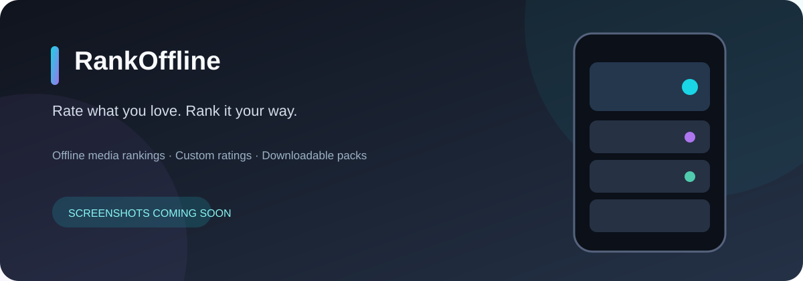

# RankOffline

**Rate what you love. Rank it your way. Keep it offline.**

A private, customizable Android app for rating and ranking your favorite media — without an account or cloud-stored ratings.



> **Current stable:** [v0.1.3](https://github.com/JulenCasajus/RankOffline/releases/latest) (anime-focused). **In development:** v0.2.0 (Anime, Manga, Movies, Series & Books). Preview images are placeholders, not app screenshots.

## ✨ Why RankOffline?

- **Your ranking, your rules.** Choose a quick 0–10 score or detailed, weighted ratings.
- **Made for your collections.** Browse Anime, Manga, Movies, Series and Books in the upcoming multi-media release.
- **Offline first.** Download only the catalogs you want; browse and rate without a connection.
- **Personal by design.** Ratings, notes and preferences stay on your device.
- **Make it yours.** Custom rating categories, profiles, color themes and appearance settings.
- **Smarter collections.** Precomputed Merge relationships keep related seasons, variants and movie collections together.

## 📱 A look inside

| Discover & browse | Rate & rank |
|:---:|:---:|
|  |  |
| *Screenshot coming soon* | *Screenshot coming soon* |

## ⬇️ Get RankOffline

**[Download the stable Android APK →](https://github.com/JulenCasajus/RankOffline/releases/latest)**

Want to test the upcoming multi-media app? Find clearly labeled **pre-releases** on the [Releases page](https://github.com/JulenCasajus/RankOffline/releases). Development builds may be unstable and are separate from the stable app.

## 🛠 Build & documentation

Built with **Kotlin · Jetpack Compose · Room · DataStore**. Requires Android Studio, JDK 17 and Android SDK 35.

```bash
./gradlew assembleDebug
```

Read more: [Architecture](docs/ARCHITECTURE.md) · [Pack format](docs/PACK_FORMAT.md) · [Personal packs](docs/CUSTOM_PACKS.md) · [Scoring](docs/SCORING.md) · [v0.2.0 progress](docs/V0.2.0_DEVELOPMENT.md) · [Roadmap](docs/ROADMAP.md) · [Releasing](docs/RELEASING.md)

## 🔒 Privacy & license

No account, analytics, telemetry or cloud rating storage. Network access is used for requested downloads, covers and other online features; personal scores and notes are not uploaded to catalog providers.

Code is licensed under **[GPL-3.0](LICENSE)**. See [trademarks](TRADEMARKS.md) for branding; catalog data and artwork belong to their respective providers and rights holders.

## ❤️ Support RankOffline

RankOffline is free and open source, built to make personal media ranking simple, customizable, and available offline.

If you enjoy the project and would like to support its continued development, you can make a one-time contribution or become a monthly supporter.

Your support helps cover development time, maintenance, testing, and future improvements.

**[Support via GitHub Sponsors](https://github.com/sponsors/JulenCasajus).**

Donations are completely optional. RankOffline will remain free and open source.

Thank you for supporting the project! ❤️
