# 🎯 RankOffline

**Rate what you love. Rank it your way. Keep it offline.**

RankOffline is a **free, open-source Android app** for discovering and ranking **Anime, Manga, Movies, Series, and Books**. Build a personal library with customizable ratings, beautiful rankings, and offline access to your installed catalogs — **no account, no cloud sync, no analytics**.

**[Download RankOffline v0.2.0](https://github.com/JulenCasajus/RankOffline/releases/tag/v0.2.0)** · [Installation](#installation) · [Rating system](#rate-your-way) · [Privacy](#offline-first-and-private)

## ✨ Discover. Rate. Rank.

| Discover your favorites | Rate your way | See your personal podium |
|:---:|:---:|:---:|
| 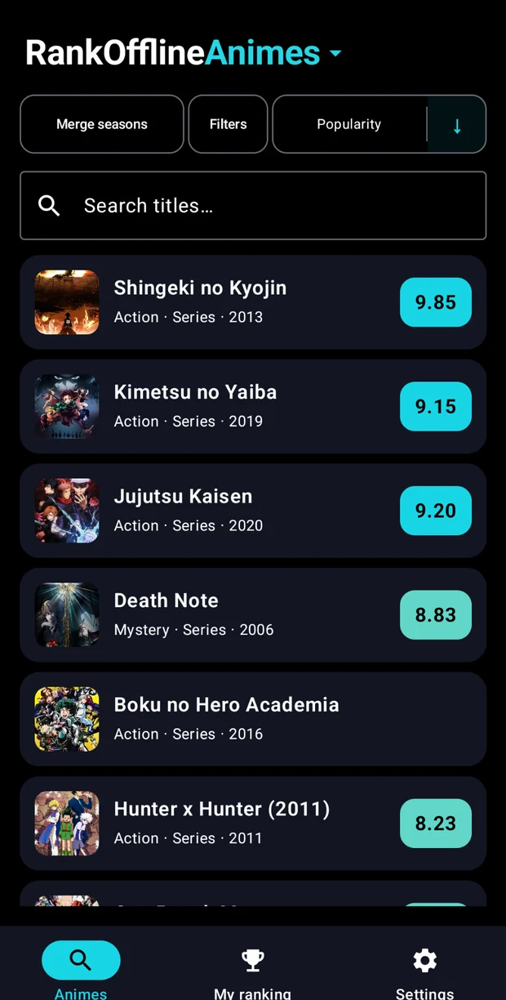 | 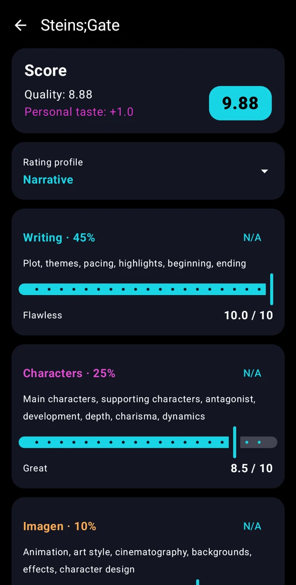 | 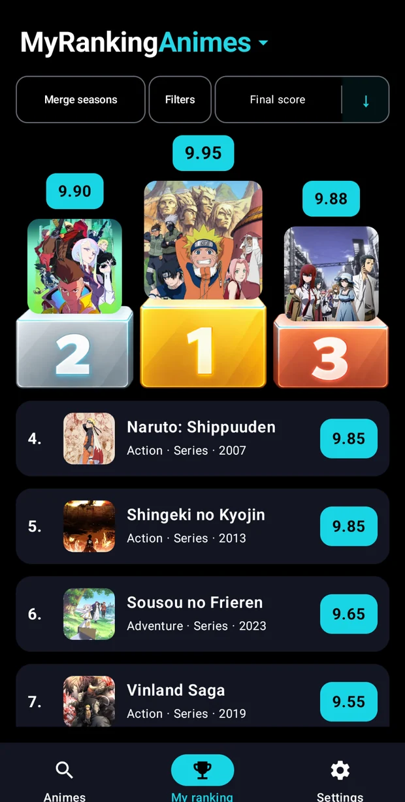 |

## 📚 Five independent offline catalogs

Choose only the categories you want. **Anime, Manga, Movies, Series, and Books** are separate downloadable data-only packs; the app itself does not require all five. After a pack is installed, you can browse its catalog, search, filter, rate, and rank **without an internet connection**.

- **Anime:** anime titles, original and alternative title search, and season relationships.
- **Manga:** searchable works, creators and conservative variant/edition grouping.
- **Movies:** individual films and verified collection grouping.
- **Series:** seasons and their parent-series grouping.
- **Books:** works, authors and conservative series grouping; usable entirely without cover art.

| Manga with artwork | Series grouped by show | Books without images |
|:---:|:---:|:---:|
| 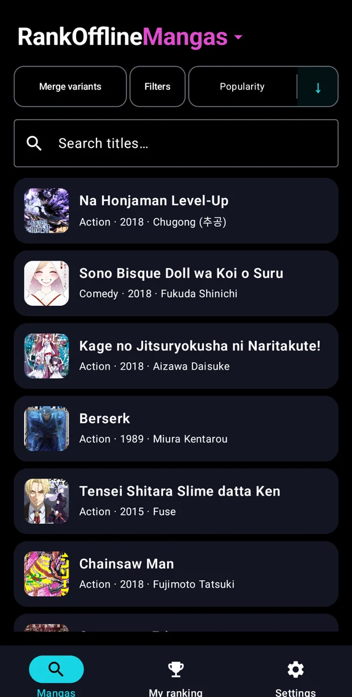 | 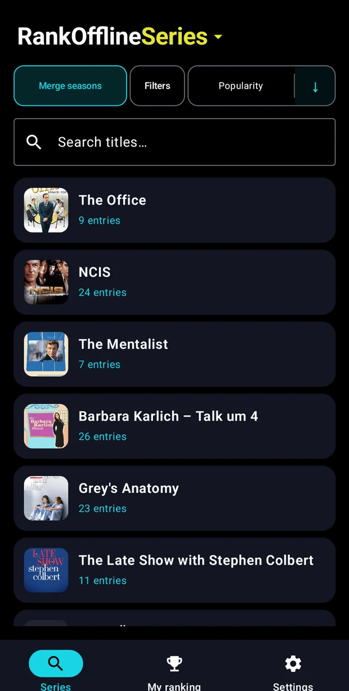 | 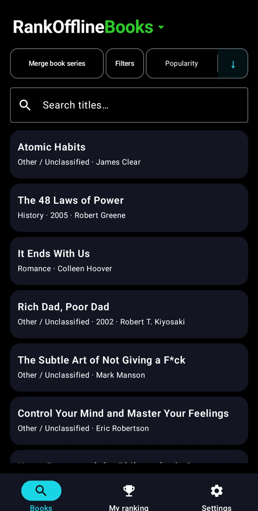 |

Cover images are **optional and downloaded separately** when requested or enabled in the settings for a new pack. They are cached locally for offline viewing. Canceling an optional cover download does not remove the installed catalog.

## ⭐ Rate your way

RankOffline offers two independent ways to evaluate a work:

**Simple rating:** choose a score from **0 to 10**, in **0.5-point steps**. Add a separate **personal taste bonus** of **+0.0 to +1.0** (in 0.1 steps) when using the scoring editor.

**Elaborate rating:** evaluate weighted categories using a reusable rating profile. Default categories include **Writing, Characters, Visuals, Worldbuilding, and Audio**. Profiles such as **General, Narrative, Character-driven, Visual / Action, World / Adventure, and Atmospheric** apply different weights. Mark categories **N/A** to exclude them and automatically renormalize the remaining weights. The separate personal-taste bonus is added after quality scoring; the final score is capped at 10.

Create and edit your own categories, category colors/descriptions, profiles, and weights. Add **personal notes** and keep a local status for each item. Saved scores are not silently recalculated just because you change a profile later.

<p align="center">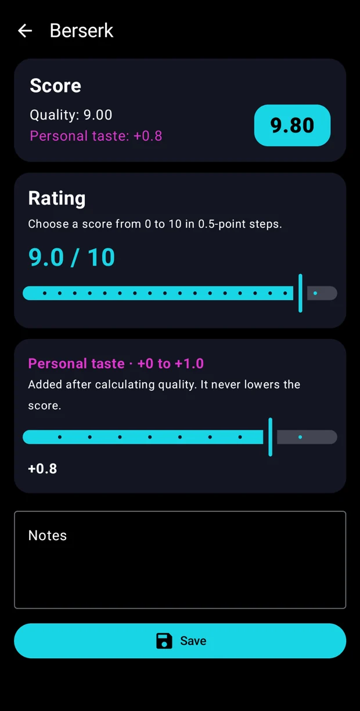</p>

Read the [scoring documentation](docs/SCORING.md) for the full formula and behavior.

## 🔎 Powerful search and sorting

Browse completely offline by title, including supported **alternative titles and aliases**. For example, searching *Attack* and *Shingeki* can find the same series using different names, while preserving the underlying identity and ratings.

| Search using an alias | Search using the main title |
|:---:|:---:|
| 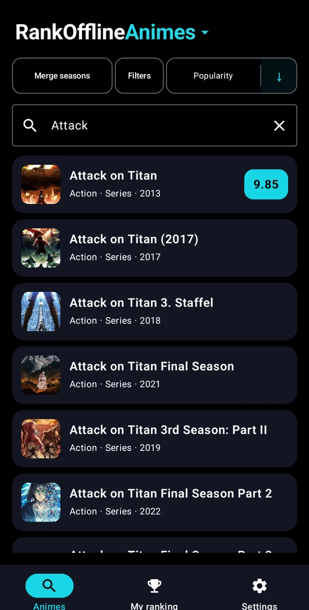 | 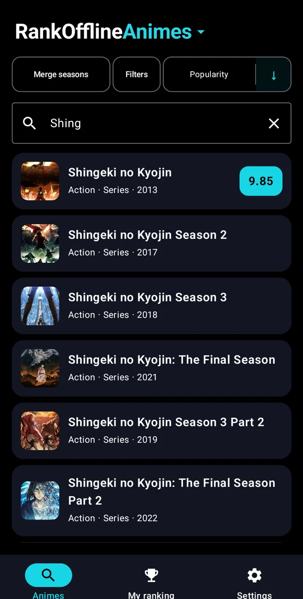 |

Use catalog-specific **genre, format, year, studio and other relevant filters** where supported. Sort by **popularity**, **name**, **final score** or individual rating categories, depending on the screen and available data. My Ranking can show a full scored list or a **Top 3 podium**, and its sort criterion changes who gets the gold, silver and bronze positions.

## 🔗 Merge seasons, collections, and variants

Switch **Merge** on or off without changing the original catalog data. RankOffline uses provider relationships prepared beforehand, not fuzzy matching on your phone. Supported examples include anime seasons, manga variants, movie collections, TV seasons, and conservatively identified book series.

| Movies as individual entries | Movies grouped by collection |
|:---:|:---:|
| 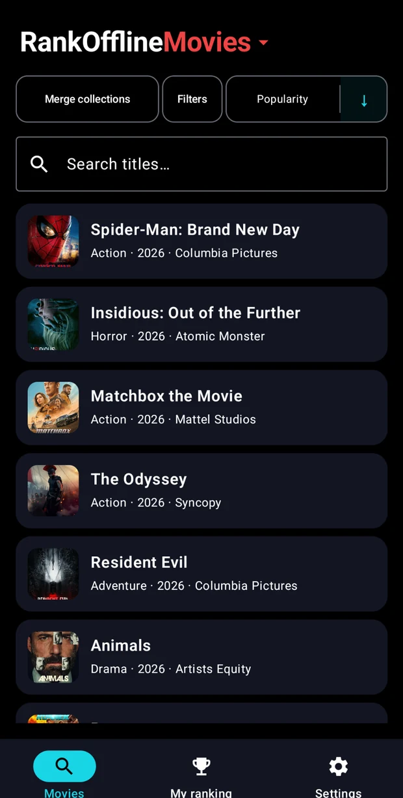 | 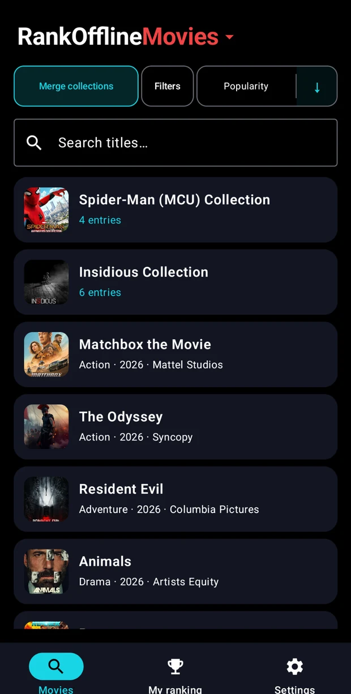 |

## 🎨 Make it yours

- **Theme palettes:** choose a built-in palette, customize supported themes, or save your own.
- **Eight launcher icons:** switch the app icon from Settings.
- **Nine interface languages:** English, Spanish, German, French, Russian, Japanese, Simplified Chinese, Basque, and Italian.
- **Per-pack settings:** choose whether to show images, merge related titles, keep the score header visible, and use one cover per group where supported.
- **Cover management:** optionally download covers, show larger artwork, and remove downloaded covers.

<p align="center">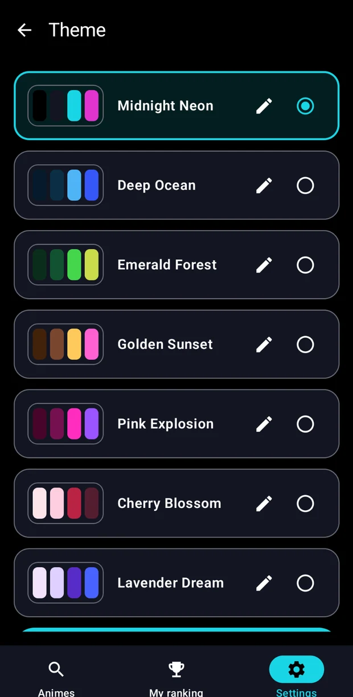</p>

<details>
<summary><strong>More screenshots: filters, category rankings, and cover viewer</strong></summary>

| Advanced filters | Rank by Writing | Full-size cover preview |
|:---:|:---:|:---:|
| 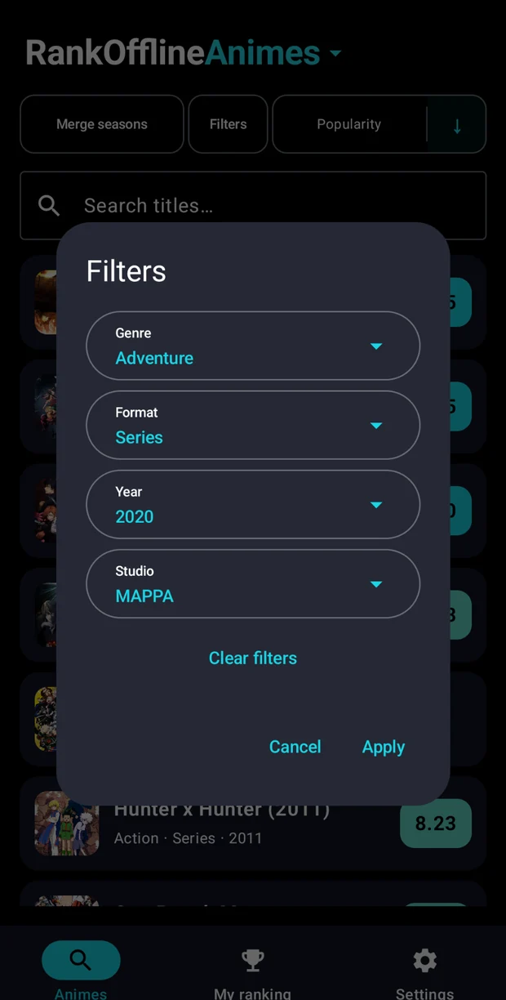 | 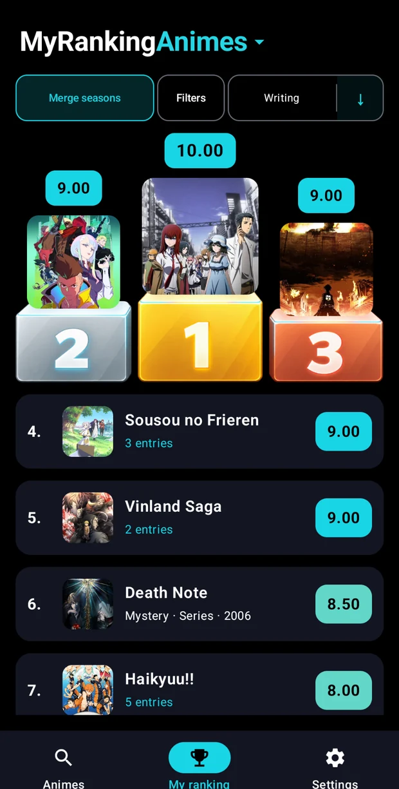 | 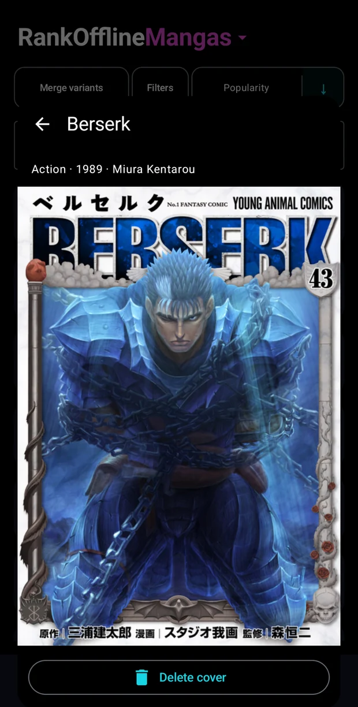 |

</details>

## 📥 Installation

**Android 8.0 (API 26) or newer.**

1. Get the signed APK from the **[latest stable GitHub Release](https://github.com/JulenCasajus/RankOffline/releases/tag/v0.2.0)** (`RankOffline-v0.2.0.apk`). Install it on Android.
2. In RankOffline, install the catalog packs you want while connected to the internet.
3. Optionally enable/download cover images. Your installed catalogs, ratings, notes, and downloaded covers then work offline.

**Obtainium:** add `https://github.com/JulenCasajus/RankOffline` as a GitHub source to track stable updates. Exclude prereleases if you only want signed stable versions. The stable app ID is `org.rankoffline.app`; development APKs use `org.rankoffline.app.debug` and are separate installations.

> **Data safety:** in v0.2.0, deleting a pack **and its data** also removes that pack's local ratings, notes, covers, and per-pack settings. Regular app updates and ordinary catalog refreshes preserve personal data. Android's automatic cloud backup is disabled.

## 🔒 Offline-first and private

- Browse, search, filter, rate, and rank installed catalogs **offline**.
- Personal ratings, notes, rating profiles, preferences, and cached covers stay in **app-private storage**.
- **No login, analytics, telemetry, or cloud rating database.**
- Network access is used for pack downloads and optional cover retrieval, **not remote title search**.
- The app uses **Jetpack Compose, Room, and DataStore**. Its data-only pack files are integrity-checked before installation.

## 🛠️ For developers

Requirements: **Android Studio, JDK 17, Android SDK 35**.

```bash
./gradlew testDebugUnitTest
./gradlew assembleDebug
```

Debug and stable builds use different Android application IDs. For a properly signed production build, see [Releasing](docs/RELEASING.md) and `tools/build_release.sh`; **do not commit signing keys or secrets**.

Useful technical resources: [Architecture](docs/ARCHITECTURE.md) · [Pack format](docs/PACK_FORMAT.md) · [Pack architecture](docs/CATEGORY_PACK_ARCHITECTURE.md) · [Scoring](docs/SCORING.md) · [Custom packs](docs/CUSTOM_PACKS.md) · [Roadmap](docs/ROADMAP.md) · [Release process](docs/RELEASING.md).

The current stable release is **v0.2.0**. Proposed features such as **RankOfflineAll**, personal-data import/export and improved background transfers are not claimed as shipped functionality. Follow [the roadmap](docs/ROADMAP.md) for future directions.

## 📖 Data sources and attribution

- **Anime:** [AnimeAPI](https://github.com/nattadasu/animeApi), [AniList](https://anilist.co), [Jikan](https://jikan.moe), and pinned title aliases from [anime-offline-database](https://github.com/cedya77/anime-offline-database).
- **Manga:** [MangaDex](https://mangadex.org).
- **Movies and Series:** [The Movie Database (TMDB)](https://www.themoviedb.org).
- **Books:** [Open Library](https://openlibrary.org).

Third-party catalogs, artwork, API responses, names and logos have their own licensing and attribution requirements, distinct from the app's license. See [Data sources](docs/DATA_SOURCES.md) and [Third-party notices](THIRD_PARTY_NOTICES.md). This app is not endorsed or certified by its data providers.

## ⚖️ License and branding

RankOffline's original application source code is free and open-source software licensed under **[GPL-3.0-only](LICENSE)**. The original RankOffline name, logos, launcher icons and distinctive branding are subject to the separate [trademark policy](TRADEMARKS.md); modified or unofficial distributions must use their own branding. Provider content is not relicensed by the app's GPL.

## ❤️ Support RankOffline

RankOffline is free and open source. If it is useful to you, you can support its continued maintenance and development through **[GitHub Sponsors](https://github.com/sponsors/JulenCasajus)**. Donations are optional and the app remains free.
